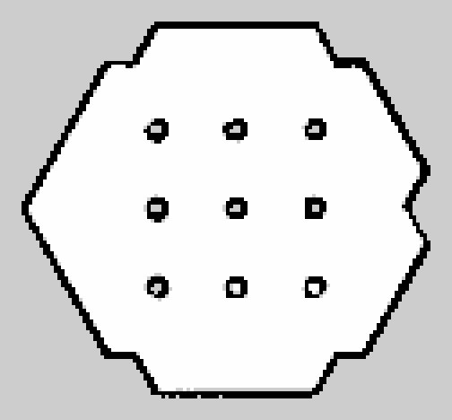
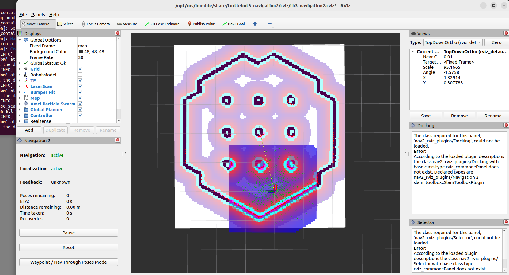
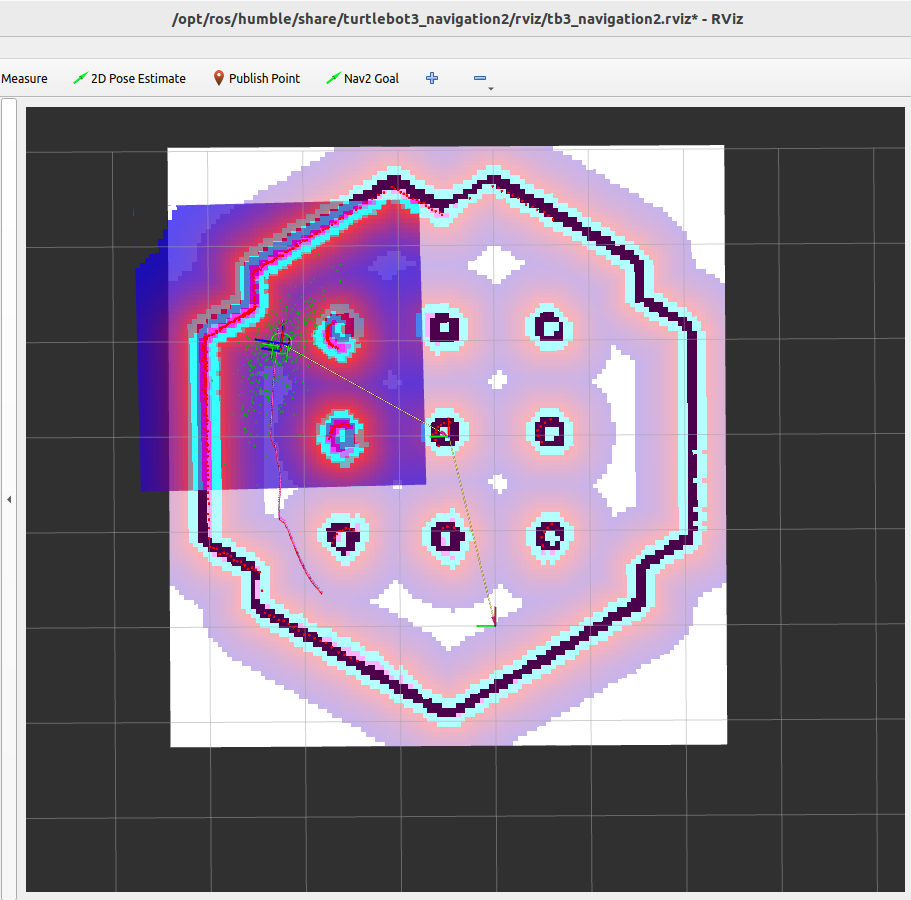

# 1 · ROS 2 TurtleBot3 development in Gazebo

First assignment of the course: getting started with ROS 2 on a simulated TurtleBot3 Burger —
mapping, navigation, topics and services.

## Task 1 — Build a map with SLAM

I drove the robot through the standard TurtleBot3 world and saved the map produced by SLAM.

| File | Content |
|---|---|
| `task1/map.pgm`, `task1/map.yaml` | occupancy-grid map (5 cm/pixel) |
| `task1/map_preview.png` | PNG copy of the map for viewing on GitHub |



## Task 2 — Autonomous navigation with Nav2

Using the saved map, I set the initial pose of the robot in RViz and sent a navigation goal to
Nav2, which localised the robot with AMCL and planned and followed a path to the goal.

| Initial pose | After navigation |
|---|---|
|  |  |

## Task 3 — Publishers and subscribers (`exercise3_task3`)

Three simple nodes in Python (`rclpy`):

| Node | What it does |
|---|---|
| `reader.py` | subscribes to `/scan` and prints the LiDAR distance in front, on the left and on the right of the robot |
| `localizer.py` | subscribes to `/odom`, converts the orientation quaternion to Euler angles and prints position and heading in degrees |
| `commander.py` | publishes a constant `Twist` on `/cmd_vel` (0.2 m/s forward, 0.5 rad/s turn) so the robot drives in a circle |

Screenshots of the output are in `task3/exercise3_task3/fig/`. The log labels of `reader.py` were
left in Italian, as in the submitted version: *Fronte* = front, *Sinistra* = left, *Destra* = right.

## Task 4 — ROS 2 services (`exercise3_task4`)

| File | What it does |
|---|---|
| `srv/Guard.srv` | custom service: request `laps` (int) and `dist` (float), response `success` (bool) |
| `spin_server.py` | `std_srvs/Empty` service that turns the robot 360° in place (time computed from the angular speed) |
| `guard_server.py` | `Guard` service: for each lap, drives forward `dist`, turns 180°, drives back and turns 180° again; it also records the odometry while moving and saves it to `data.csv` |
| `guard_client.py` | calls the guard service twice: once with 1 lap at 0.6 m, then 2 laps at 0.4 m |

## Run

```bash
colcon build --packages-select exercise3_task3 exercise3_task4
source install/setup.bash
ros2 run exercise3_task3 reader.py          # or localizer.py / commander.py
ros2 run exercise3_task4 guard_server.py    # in a second terminal:
ros2 run exercise3_task4 guard_client.py
```
