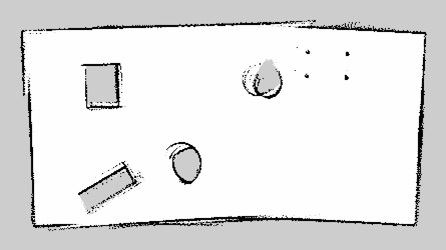

# 3 · Mapping with a 2D LiDAR and ICP

Third assignment: estimating the motion of the robot by matching consecutive LiDAR scans with the
Iterative Closest Point (ICP) algorithm, and building an occupancy-grid map from them.

## Task 1 — ICP step by step (`Task_1/Task_1.pdf`)

A worked example of one point-to-point ICP iteration on given data: from the covariance matrix
**H** and the centroids of the two point sets, I compute the SVD of **H**, check the determinant of
**VUᵀ** to exclude a reflection, derive the optimal rotation **R** and translation **t**, and build
the homogeneous transformation matrix **T**.

## Task 2 — LiDAR scan mapper (`Task_2/ros2_scan_mapper.py`)

A ROS 2 node that builds a map of an unknown room using only the LiDAR (no wheel odometry):

1. **Scan → points.** Each `/scan` is converted from polar to Cartesian coordinates; every 12th
   scan is processed, to have enough motion between matched scans.
2. **ICP registration (my implementation).** For each iteration: nearest neighbours with a
   KD-tree, rejection of pairs farther than 0.4 m, centroids, covariance matrix, SVD, rotation
   with reflection correction (det = +1), translation, and accumulation of the homogeneous
   transform. It stops after 60 iterations or when a step becomes very small.
3. **Quality gate.** A match is accepted only if enough points overlap (fitness ≥ 0.35) and the
   RMSE is low (≤ 0.15 m); poor matches, e.g. during fast turns, are rejected so they do not
   corrupt the pose.
4. **Pose update.** The relative motion is rotated into the map frame and added to the robot
   pose, which is broadcast as a `map → base_link` transform.
5. **Occupancy grid.** Each beam endpoint is marked as occupied and the cells along the ray
   (Bresenham's line algorithm) as free, with Bayesian log-odds updates and clamping. The map is
   published on `/map` at 2 Hz and saved with the Nav2 map saver.

### Result



The map (`my_map.pgm` / `my_map.yaml`, 2.5 cm/pixel) shows the walls of the room and the
obstacles inside it. Some drift is still visible in the slightly curved walls, which is expected
for scan-to-scan ICP without loop closure. A screen recording of the mapping run is in
`Task_2/lidar_mapping_run.mp4`.

```bash
python3 ros2_scan_mapper.py     # with the Gazebo world running and the robot driven by teleop
ros2 run nav2_map_server map_saver_cli -f my_map
```

Dependencies: `numpy`, `scipy`, `matplotlib`, `open3d` (used only by the optional evaluation
function), `tf2_ros`.
