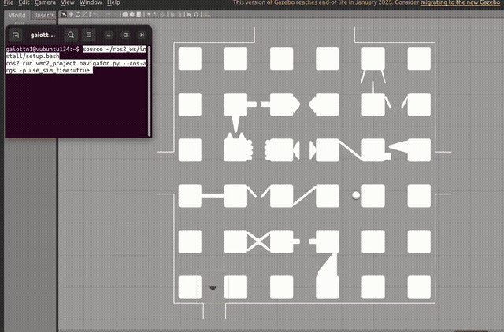

# 4 · Final project — maze navigation with blocked passages

Final project of the course, carried out in a team of two students.

A TurtleBot3 Burger must reach a goal on the far side of a maze. The free space is modelled as a
**5 × 5 grid of nodes**, but some passages between nodes contain obstacles: some leave a gap wide
enough for the robot, others block the way. The robot does not know in advance which ones are
blocked, so it has to find out with the LiDAR while driving and adapt its route.



*Full run at 6× speed. The complete recording is in [`media/maze_full_run.mp4`](media/maze_full_run.mp4).*

## How it works (`vmc2_project/src/navigator.py`)

The node runs a control loop at 20 Hz with four modes: **FOLLOW**, **BACKTRACK**, **REPLAN** and
**DONE**.

**1. Global planning — A\*.** The grid is stored as a graph with 4-neighbour edges. A\* (with a
priority queue and Euclidean cost and heuristic) finds the sequence of nodes from the node closest
to the robot to the node closest to the goal; the robot position and the exact goal are added at
the two ends of the path.

**2. Passability check with the LiDAR.** At the start of each segment the robot stops briefly and
looks ahead:
- the LiDAR points are transformed from the sensor frame to the world frame, and then into a frame
  aligned with the segment (distance along it and lateral offset);
- only the points between the robot and the next node, within a band of ±0.45 m around the
  segment line, are kept;
- projecting them on the lateral axis, the free intervals between points are compared with the
  robot width plus a safety margin (0.178 m + 2 × 0.01 m);
- the edge is declared **blocked** only after 3 consecutive scans without a wide enough gap, and
  scans are ignored while the robot turns fast, since scan and odometry are not synchronised.
  After the first 0.3 m of the segment the decision is kept, so LiDAR noise close to the obstacle
  cannot change it.

**3. Obstacle-aware target and path following.** The target is a pure-pursuit lookahead point
(0.3 m) on the current segment, shifted sideways towards the centre of the free gap with a
low-pass filter; the shift fades out near the end node so the robot arrives exactly on it.
The controller then:
- turns in place when the heading error is larger than 0.3 rad, using the PID controller on the
  heading error (in the final tuning a proportional gain only, Kp = 3);
- otherwise follows a pure-pursuit arc through the target (`ω = v · 2y / L²`), with the speed
  reduced near the target and limited to the TurtleBot3 maximum (0.22 m/s, 2.84 rad/s).

**4. Backtracking and replanning.** When an edge is blocked, the robot stops, drives **in reverse**
back to the previous node, removes the blocked edge from the graph, replans with A\* from that
node and continues. This repeats until the goal is reached.

A live OpenCV window shows the grid, the planned path, the robot, the lookahead target and the
current mode.

## Package contents

```
vmc2_project/
├── src/navigator.py                 # planning, perception and control node
├── launch/project.launch.py         # Gazebo world + TurtleBot3
├── launch/spawn_turtlebot3.launch.py
├── worlds/project.world             # maze with obstacles
├── worlds/project_no_obs.world      # same maze without obstacles (for testing)
└── models/turtlebot3_burger/        # robot model
```

## Run

```bash
colcon build --packages-select vmc2_project && source install/setup.bash
export TURTLEBOT3_MODEL=burger
ros2 launch vmc2_project project.launch.py
ros2 run vmc2_project navigator.py       # in a second terminal
```

The maze models (`project_track`, `project_track_no_obs`) were provided with the course and are
not included here. The package template, launch files and given helpers (grid graph, polyline
utilities, PID class, visualisation) come from the course; the planning, passability check,
target generation, controller and mode logic were written by our team.
